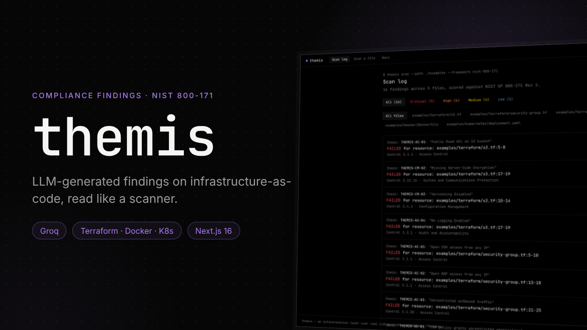
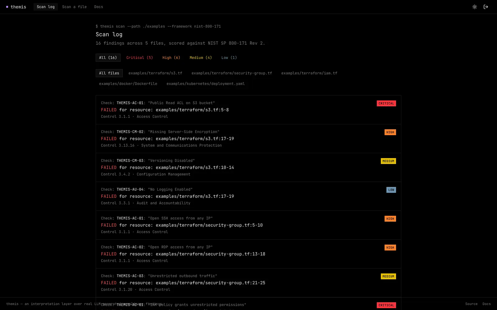
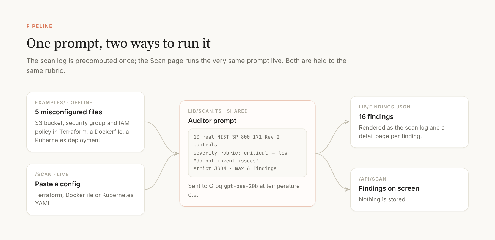
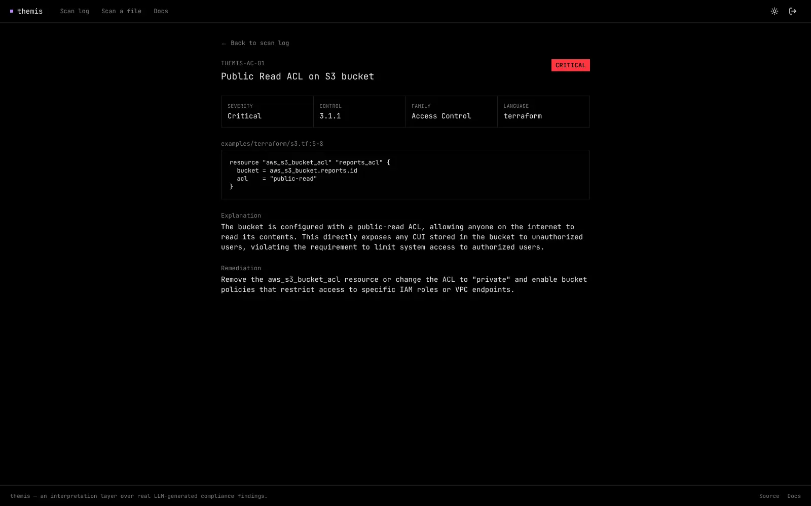

# Themis



**LLM-generated compliance findings, read like a scanner.** Named for the Greek goddess of divine law and justice, whose scales are a classic symbol of audit. Themis is an interpretation layer over CMMC / NIST SP 800-171 findings on infrastructure-as-code: a terminal-style scan log, finding detail pages and a live "paste a file, get findings" feature.

Part of [Siegfried](https://github.com/joshrubio/Siegfried), a series of five satellite projects. Case study: [joshrubio.es/projects/themis](https://joshrubio.es/projects/themis)

This is deliberately **not** a real compliance scanner. It has no AST parser, no policy-as-code rule engine and no access to live cloud infrastructure, unlike [Checkov](https://checkov.io) or [tfsec](https://github.com/aquasecurity/tfsec). It is the UX layer on top of whatever an LLM flags, and its `/docs` page says plainly that it isn't a certified assessment tool.



## How it works



- **Examples**: five deliberately misconfigured files under `examples/`: a Terraform S3 bucket, security group and IAM policy, a Dockerfile and a Kubernetes deployment.
- **One shared prompt** (`lib/scan.ts`): a system prompt with ten real **NIST SP 800-171 Rev 2** controls and their families, a severity rubric (critical, high, medium, low), an instruction not to invent issues, and a strict JSON schema. Sent to Groq (`openai/gpt-oss-20b`) at temperature 0.2.
- **Offline**: `scripts/scan.ts` scanned the examples once and committed the 16 findings to `lib/findings.json`.
- **Live**: `/scan` sends whatever Terraform, Dockerfile or Kubernetes config you paste through the same prompt via `/api/scan`. Nothing is stored.

Because both paths use the same prompt, the live feature is held to exactly the same rubric as the precomputed data.

## The app

- **Scan log** (`/`): Checkov-style rows (`Check: <id>: "<title>"`, `FAILED for resource: <file>:<lines>`, the control), filterable by severity and by file.
- **Finding detail** (`/findings/[id]`): a Wiz-style metadata grid (severity, control, family, language), the offending snippet, an explanation and a remediation.
- **Scan a file** (`/scan`): the live feature.
- **Docs** (`/docs`): what this is and isn't, and how severity is scored.



## Identity

Benchmarked against Wiz's finding cards and Checkov's terminal scan-log format: a single monospace typeface (JetBrains Mono) everywhere, zero corner radius, a violet accent reserved for functional signals, and severity colors used as data, not decoration.

## Running locally

```bash
npm install
npm run dev
```

The live scan needs `GROQ_API_KEY` in `.env.local`; the scan log and finding pages work without it. The login page is a demo gate.

To regenerate `lib/findings.json` from scratch:

```bash
npx tsx scripts/scan.ts
```

## Stack

Next.js 16 (App Router, Cache Components) · TypeScript · Tailwind CSS v4 · shadcn/ui (`@base-ui/react`) · Groq (`openai/gpt-oss-20b`).
